## What it does

Adds a **Bookmarks** panel to the left sidebar: a compact bookmark strip on top and a large inline browser underneath. Clicking a bookmark opens the page inside DSH — no external browser, no iframe that sites refuse to render.

## Highlights

- **One guest, many sites.** A real Electron `<webview>` acquired from the desktop `dshDesktop.browser` bridge (the same mechanism as the built-in browser), so `X-Frame-Options` / CSP never get in the way.
- **Desktop or mobile per bookmark.** Each bookmark stores its own user agent; the toolbar chip flips it live and writes the choice back. Mobile bookmarks keep a small phone badge in the strip.
- **Survives panel switching.** The `<webview>` lives in a fixed layer under `body` whose box tracks the panel's placeholder, so leaving the panel only hides it. The guest is never destroyed: scroll position, form contents and playback stay put.
- **Usable right away.** Empty state accepts a URL, back/forward/reload are live, the address bar follows in-page navigation, and a small context menu inside the page covers back/forward/reload/copy/select all.
- **Console built in.** Eruda is injected into every loaded page (Console / Elements / Network / Resources); its own entry button opens and closes the panel. Injection runs through `executeJavaScript`, so a site's CSP cannot block it and no desktop DevTools switch is involved.
- **Theme-aware.** Every surface uses `--dsw-alias-*` tokens with fallbacks, so it follows light and dark palettes.

## Requirements

DSH desktop (Electron). The pure Web build has no guest bridge and shows an "inline browsing needs the desktop client" notice.

## Known limits

- While the panel is closed the page keeps running in the background (one renderer stays alive). A full window reload or restart still reopens the address from `sessionStorage`, and that page does load again.
- Eruda is page DOM: a full re-render by the site can wipe its entry button — reload the page to get it back.
- The injected context menu replaces the site's own right-click menu.
