## 它做什么

在左侧边栏加一个**书签导航**面板：上面一条紧凑书签带，下面整块区域是内嵌浏览器。点书签就在 DSH 里打开网页 —— 不跳外部浏览器，也不用会被站点拒绝的 iframe。

## 特点

- **一个 guest 打开所有站点**：走桌面端 `dshDesktop.browser` 桥创建真正的 Electron `<webview>`（与内置浏览器同一机制），完全绕过 `X-Frame-Options` / CSP。
- **每个书签单独选桌面或移动端 UA**：工具栏胶囊一键切换并写回书签，移动端书签在书签带上带手机角标。
- **切面板不丢页面**：`<webview>` 常驻在 `body` 下的固定层里，层的位置跟随面板占位框；切走只是隐藏，guest 从不销毁，滚动位置、表单内容与播放进度都保留。
- **开箱可用**：空状态直接输网址；后退/前进/刷新可用，地址栏跟随站内跳转；页面内注入的小右键菜单提供后退/前进/刷新/复制/全选。
- **自带控制台**：每次页面加载完自动注入 Eruda（Console / Elements / Network / Resources），开关用它自己的入口按钮；注入走 `executeJavaScript`，不受站点 CSP 限制，也不需要桌面端 DevTools。
- **跟随主题**：所有表面都用 `--dsw-alias-*` 令牌并带 fallback，明暗主题都协调。

## 运行要求

DSH 桌面端（Electron）。纯 Web 版没有 guest 桥，面板会提示需要桌面端。

## 已知限制

- 面板切走期间网页仍在后台运行（常驻一个渲染进程）；窗口整体刷新或重启后仍按 `sessionStorage` 重开，那时页面会重新加载。
- Eruda 是页面内 DOM，站点整页重绘可能把入口按钮一起清掉，重新加载页面即可。
- 注入的右键菜单会覆盖站点自己的右键菜单。
